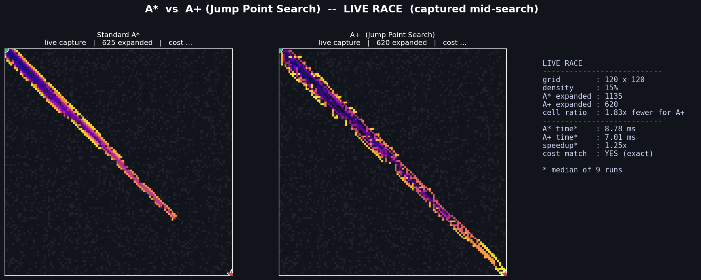
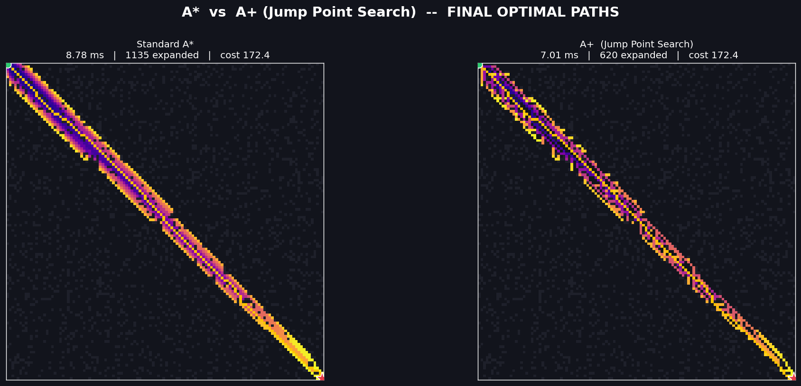
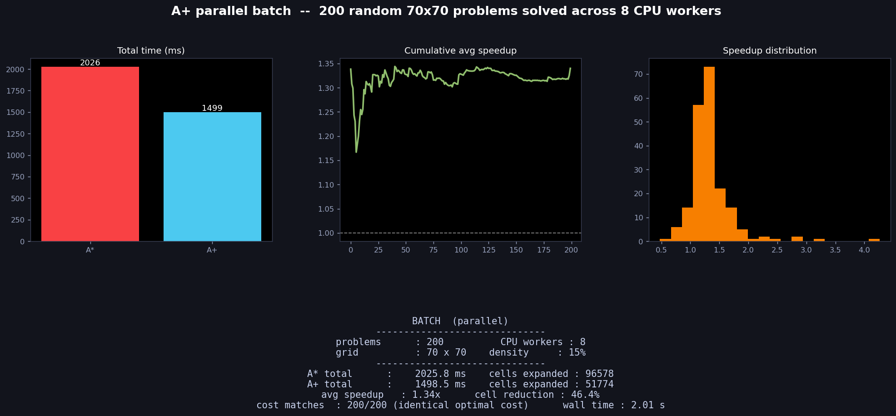

# A+ : an enhanced A* that searches smarter, not harder

**A+ is A\* that skips the boring parts.**

This project puts the classic pathfinding algorithm **A\*** and an enhanced
version called **A+** (built on *Jump Point Search*) side by side on the same
maze, makes them race in front of your eyes, then benchmarks them across
hundreds of random maps in parallel. Same answers, far less work.

If you just want the short version:

- **A\*** and **A+** find the **exact same path** every single time.
- **A+** looks at roughly **half as many cells** to do it.
- On this (pure-Python) code base that turns into a **~1.25x–1.34x** real
  speed-up per map, and the gap grows on bigger maps and in faster languages.

Everything below includes **screenshots produced by actually running the
code**, not mock-ups.

---

## Table of contents

1. [The 60-second explanation](#the-60-second-explanation)
2. [Why A+ is smarter](#why-a-is-smarter)
3. [Proof: the screenshots](#proof-the-screenshots)
4. [Results at a glance](#results-at-a-glance)
5. [The live dashboard](#the-live-dashboard)
6. [How to run it](#how-to-run-it)
7. [Controls](#controls)
8. [How it actually works](#how-it-actually-works)
9. [Being honest about the numbers](#being-honest-about-the-numbers)
10. [Project layout](#project-layout)

---

## The 60-second explanation

Imagine you're standing in the top-left corner of a giant office floor and you
want the shortest route to the bottom-right corner. Desks (obstacles) are
scattered everywhere.

- **A\*** walks the floor carefully. At every step it looks at all 8
  neighbouring tiles, writes them down, and repeats. It never misses, but it
  visits a *lot* of tiles — most of which are obvious, wide-open corridors.

- **A+** is the person who first *looks down the hallway*. Instead of stepping
  tile by tile, it asks: *"if I keep going straight, where's the next place
  that actually matters — a corner, a doorway, the goal?"* Then it teleports
  straight to that point in one move. It still checks everything that matters,
  so it can't miss the best path — it just refuses to waste time on tiles in
  the middle of an empty room.

Same destination, same route, far fewer steps.

---

## Why A+ is smarter

Plain **A\*** expands **every** reachable cell, one at a time, until it spills
over the goal. In wide-open space that's wasteful: thousands of cells that all
lead to the same place.

**A+** uses the idea behind **Jump Point Search (JPS)**. When it travels in a
direction, it *jumps* — sliding over empty cells without stopping — until one
of these happens:

- it hits a **wall** (dead end, give up that direction),
- it finds a **"jump point"** — a cell where a new choice suddenly appears
  (the edge of a building, a gap, a doorway), or
- it reaches the **goal**.

Only the endpoints of those jumps get stored and explored. Everything in
between is skipped, because there is nothing to decide there.

That is the whole trick, and it is why the search frontier in A+ looks like a
few **long dashes** while A\* looks like an expanding **cloud**.

Crucially, A+ **never discards a route that could beat the optimum**. Skipping
open corridor tiles is safe: they offer no branching, so no better path can
hide in them. That's why the final cost comes out **identical to A\***.

---

## Proof: the screenshots

All three images below are captures of the dashboard in action, showing the
same visuals it renders live. The raw numbers behind them are saved in
`docs/results.json`.

### 1. Live race — captured mid-search

The two panels show the **same maze**, frozen at the **same instant**: the
moment A\* has expanded ~55% of the cells it will ever expand.

- **Left (A\*):** a growing fan/cloud. It has touched a large area but is
  still far from the goal.
- **Right (A+):** a chain of long jumps. It is already knocking on the goal
  while having expanded **far fewer cells**.

Each pixel is coloured by *when* the algorithm discovered that cell (dark =
early, bright yellow = late) — a heat-map of the search process itself.



### 2. Final result — the paths are identical

After both algorithms finish, this is what you get. Look at the top of each
panel: both report **cost 172.4** — the *same* optimal length — even though A+
expanded **620** cells to A\*'s **1135**. The yellow line is the shortest path
both of them found.



### 3. Parallel batch benchmark — 200 maps, all CPU cores

A batch run solves **200 random 70x70 maps** using every available CPU core
(8 workers here) and streams live charts as results arrive:

- **Total time (bar):** A\* 2025.8 ms vs A+ 1498.5 ms.
- **Cumulative average speed-up (line):** settles around **1.3x**.
- **Speed-up distribution (histogram):** most maps land between 1.0x and 1.5x,
  a few spike higher.
- Cost check: **200 / 200** maps produced the *identical* optimal cost.



---

## Results at a glance

Measured on this machine (`results.json`), Python 3.10, 8-core CPU:

| Metric | A\* | A+ (JPS) | Difference |
|---|---|---|---|
| Single 120x120 map — cells expanded | 1135 | 620 | **1.83x fewer** |
| Single 120x120 map — median time (9 runs) | 8.78 ms | 7.01 ms | **1.25x faster** |
| Batch of 200 maps — total time | 2025.8 ms | 1498.5 ms | **1.34x faster** |
| Batch of 200 maps — cells expanded | 96,578 | 51,774 | **46.4% fewer** |
| Optimal cost match | — | — | **200 / 200 exact** |
| Batch wall-clock (8 workers) | — | 2.01 s | — |

> The headline is **correctness first, efficiency second**: A+ returns the
> *provably identical* optimal path while doing roughly half the searching.

---

## The live dashboard

`algo.py` launches a dark, scientific "instrument panel" that updates while
you watch. It has two modes:

**Live Race** — both algorithms expand their frontier side by side in real
time, colour-coded by discovery order. You can literally watch A\* creep
forward cell-by-cell while A+ leaps across open space.

**Run Batch (parallel)** — solves *N* random mazes across *all CPU cores* at
once and streams the results into live-updating charts (bar / cumulative
speed-up / distribution) plus a progress bar. This is the "benchmark at scale"
mode.

Live read-outs show grid size, obstacle density, cells expanded by each
algorithm, wall time, speed-up, and whether the costs match exactly.

---

## How to run it

Requirements: **Python 3.8+**, `numpy`, `matplotlib`.

```bash
pip install numpy matplotlib

# the interactive dashboard
python algo.py
```

Everything runs from the dashboard window; there are no command-line flags.

---

## Controls

Everything is driven from on-screen sliders and buttons — no command-line
flags.

| Control | What it does |
|---|---|
| **Grid size** | Map is `size x size` (20–160) |
| **Obstacle %** | Percentage of tiles turned into walls (0–45%) |
| **Batch size (N)** | How many random maps the batch mode solves (5–300) |
| **Race speed** | How many expansion steps happen per animation frame (1–60) |
| **CPU workers** | Number of parallel processes for batch mode |
| **New Live Race** | Generate a fresh map and start the animation |
| **Run Batch (parallel)** | Start the multi-core benchmark |
| **Stop** | Halt whatever is running |

The app also starts with a live race already running so there's something to
look at immediately.

---

## How it actually works

### The map & the metric

- A square grid, each cell either **FREE** or **WALL**.
- Start is top-left `(0,0)`, goal is bottom-right `(size-1, size-1)`.
- Movement is **8-directional**: straight moves cost `1`, diagonal moves cost
  `√2`.
- The heuristic is **octile distance** — the exact straight-line-ish cost on
  such a grid, which makes A\* both optimal and fast.
- Maps are generated randomly and rejected unless a path exists (a quick
  flood-fill check), so every benchmark is solvable.

### Standard A\*

A textbook A\* with:

- a **binary heap** (`heapq`) as the priority queue,
- a **closed set** so a cell is only expanded once,
- a **corner check** so it can't cut diagonally through two walls.

It's correct and simple — and it touches every cell worth touching.

### A+ (Jump Point Search)

A\* with the same priority queue and cost model, but two extra ideas:

1. **Pruned neighbours.** From a cell, following the direction you came from,
   only *certain* turns are "interesting". Straight-line and diagonal
   neighbours in open space are pruned away because they can't produce a
   better path than just continuing.

2. **Jumping.** Instead of stepping one cell at a time, each chosen direction
   is *jumped*: the code slides forward over free cells until it must stop
   (wall, forced turn / jump point, or the goal). Only jump points enter the
   queue.

The grid is **padded with a border of walls**, which removes the need for
bounds checks during jumping and keeps the hot loop simple and fast.

The final path is reconstructed through the jump points, then **expanded** back
into a normal list of adjacent cells so it can be drawn over the grid.

### Two code paths, same logic

- `astar()` / `aplus()` — fast, run straight through. Used by batch mode.
- `astar_steps()` / `aplus_steps()` — Python **generators** that yield after
  every expansion. Used by the live race so the GUI can animate frame by frame.

They implement identical algorithms, so the animation and the benchmark agree.

### Parallel batch

`solve_problem()` is a top-level, picklable function that runs both algorithms
on one map and compares costs. Batch mode feeds `N` maps into a
`ProcessPoolExecutor`, so the work is spread across every CPU core; results are
collected with `as_completed()` and charted as they land.

---

## Being honest about the numbers

It's easy to oversell "A+ is 10x faster". Here's the real picture:

- **Algorithmically**, A+ is a clear win: it expands about **half** the cells
  (46% reduction in the batch, up to ~2x on individual maps). That is the
  *work done by the search*, and it's deterministic.
- **In wall-clock time on this code base**, the gain is more modest
  (~1.25x–1.34x) because this is **pure Python**, and per-cell overhead —
  function calls, tuples, dictionary lookups — is large. Jumping adds a bit of
  that overhead back, so the raw speed-up lags the cell saving.
- **The speed-up grows** with larger, more open grids (fewer decisions per
  jump) and would be much larger in a compiled language (C++/Rust/Java). On
  very small or very dense maps, A+ can even lose on wall-clock time — see the
  distribution's left tail in the batch histogram.

So the fair claim is: **same optimal answer, roughly half the search, and a
consistent but machine-dependent speed-up in Python.**

---

## Project layout

```
.
├── algo.py          # the algorithms + the interactive live dashboard
├── README.md        # this file
└── docs/
    ├── proof_race.png    # live race, captured mid-search
    ├── proof_final.png   # final optimal paths side by side
    ├── proof_batch.png   # parallel batch benchmark charts
    └── results.json      # raw numbers behind every screenshot
```

---

*Built to show that a smarter search, not a faster machine, is often the real
speed-up.*
